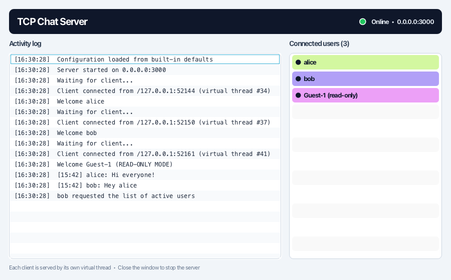
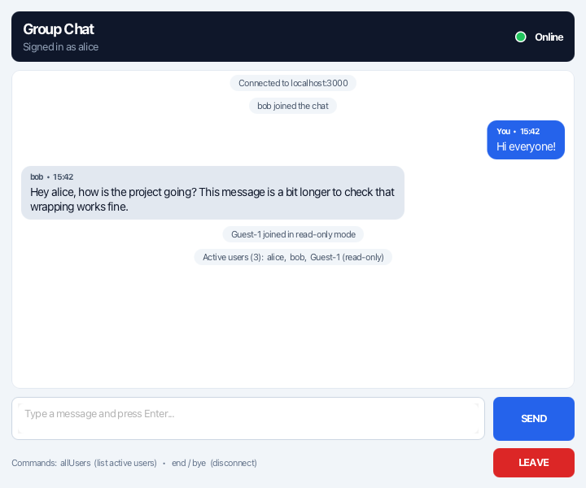
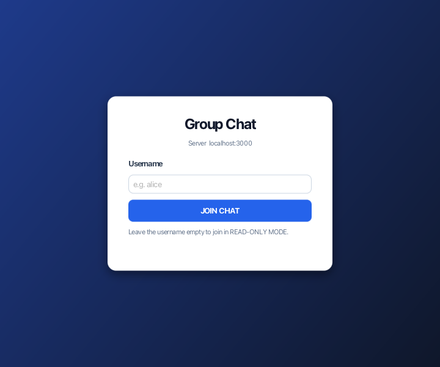
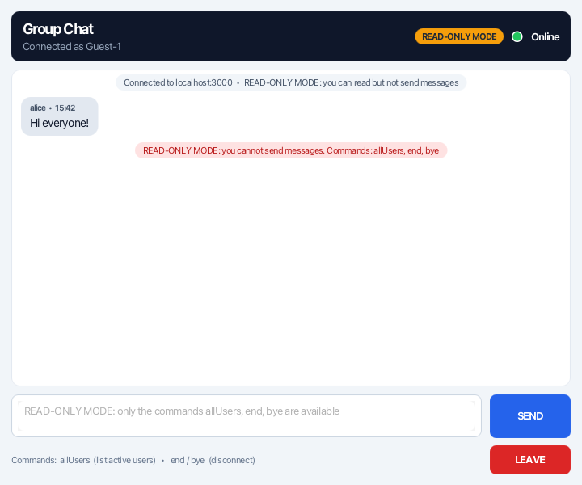
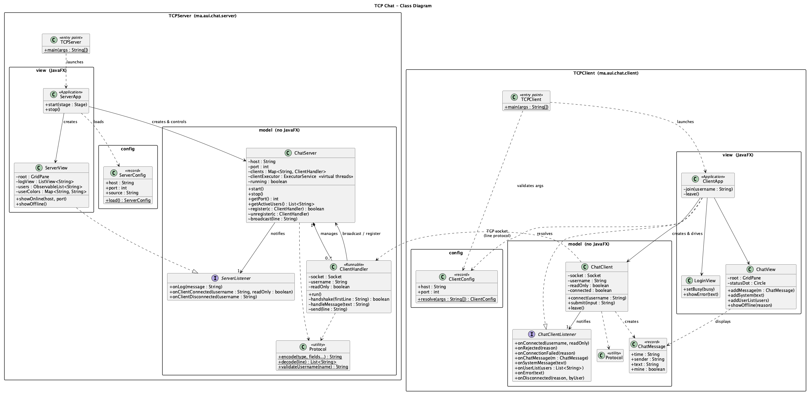
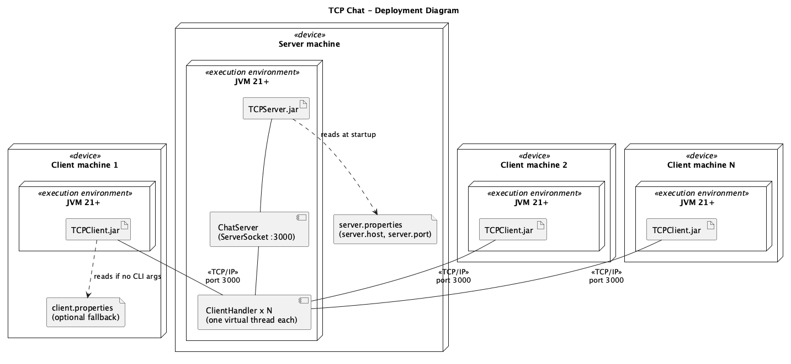
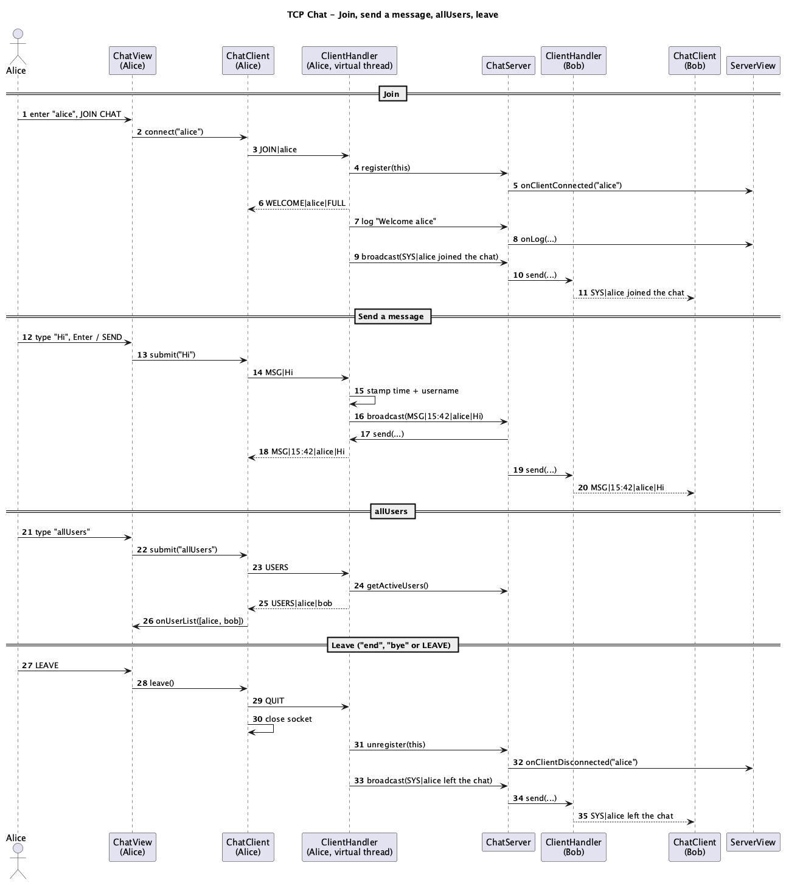
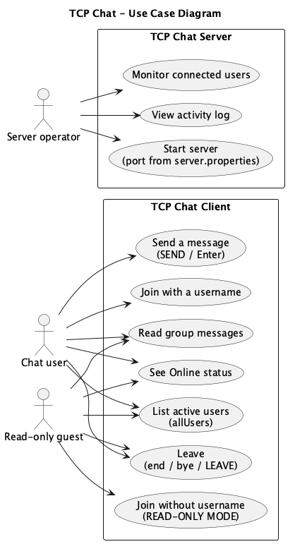

# Multi-Client Chat Application Using Java Sockets

Mini Project 1: a group chat over **TCP sockets** with a **JavaFX** interface. A central server accepts many clients at once (one **virtual thread** per client) and relays every message, stamped with the sender's username and the time, to all connected users.

| Server | Client |
|---|---|
|  |  |
|  |  |

## Features

**Client (`TCPClient`)**
- **Username login.** You enter a username before you can use the chat.
- **READ-ONLY MODE.** If you join with an empty username, you can read the chat but not send to it. The server enforces this too.
- **Messaging.** Type in the text area and press **SEND** or **Enter**. Shift+Enter adds a new line.
- **`allUsers`** asks the server for the list of active users. Only you get the answer.
- **`end` / `bye` / LEAVE button** closes the connection and tells the server.
- **Status indicator.** A green "Online" dot shows the connection. It turns red "Offline" if the server goes away.
- Duplicate or invalid usernames are refused, with an error on the login screen.

**Server (`TCPServer`)**
- Handles many clients at once, each on its own virtual thread.
- Formats each message with the sender's username and the time (`HH:mm`), then sends it to every client.
- Keeps a live `ListView` of connected users, each with a random background colour.
- Shows an activity log: *Server started*, *Waiting for client...*, *Welcome alice*, messages, and disconnections.

## Requirements

- **JDK 21 or newer.** Virtual threads became final in Java 21.
- You don't need to install JavaFX or Maven separately. The JARs bundle JavaFX for Windows, Linux and Apple Silicon macOS, and the Maven wrapper (`mvnw`) downloads Maven when needed.

## Build

```bash
./mvnw clean package          # Windows: mvnw.cmd clean package
```

This builds both projects, runs the unit tests and produces:

- `TCPServer/target/TCPServer.jar`
- `TCPClient/target/TCPClient.jar`

You can also build each project on its own (`cd TCPServer && ../mvnw package`), or open the root `pom.xml` in IntelliJ IDEA.

## Run

```bash
java -jar TCPServer/target/TCPServer.jar
java -jar TCPClient/target/TCPClient.jar localhost 3000
```

The client usage is `TCPClient <ServerIPAddress> <PortNumber>`. Start as many clients as you like, from the same machine or from other machines on the network, using the server's IP address.

From source: `cd TCPServer && ../mvnw javafx:run`, then `cd TCPClient && ../mvnw javafx:run`.

## Configuration (no recompilation needed)

The server reads its address and port from `server.properties`:

```properties
server.host=0.0.0.0
server.port=3000
```

Where settings come from, highest priority first:

1. **Client only:** the command-line arguments `<ServerIPAddress> <PortNumber>`.
2. A `server.properties` / `client.properties` file in the folder you run the JAR from, or any file passed with `-Dconfig=path/to/file.properties`.
3. The defaults packaged inside the JAR (`src/main/resources`).

So moving the server to port 5000 only takes editing a properties file next to the JAR.

## Architecture

### Model-view separation

Each project has the same three packages:

| Package | Responsibility | Depends on JavaFX? |
|---|---|---|
| `model` | Sockets, threads, protocol, chat rules (`ChatServer`, `ClientHandler`, `ChatClient`, `Protocol`) | **No** |
| `view` | JavaFX windows (`ServerApp`/`ServerView`, `ClientApp`/`LoginView`/`ChatView`), GridPane layouts, CSS | Yes |
| `config` | Loads network settings from `.properties` files / CLI args | No |

The model reports events through an **observer interface** (`ServerListener`, `ChatClientListener`). The JavaFX classes implement it and use `Platform.runLater` to move each update onto the UI thread. The model never imports JavaFX, so you can replace the UI without touching it.

The unit tests show this in practice: they run the real `ChatServer` and `ChatClient` over real sockets with no UI at all.

### Concurrency

- `ChatServer.start()` binds a `ServerSocket` and runs the accept loop on a virtual thread.
- Each accepted socket is handed to `Executors.newVirtualThreadPerTaskExecutor()`, so every `ClientHandler` gets its own virtual thread. Blocking `readLine()` calls are cheap, and the server log shows the thread id of each connection.
- Connected clients are kept in a `ConcurrentSkipListMap`. Usernames are claimed atomically with `putIfAbsent`, so two users can never end up with the same name.
- `ClientHandler.send()` is `synchronized`, because several handler threads may broadcast to the same client at once.
- On the client, a virtual thread reads from the server, so the UI never blocks.

### Protocol

The protocol is UTF-8 text, one message per line: `TYPE|field|field...`. Inside a field, `|`, `\` and line breaks are escaped, so a message can never break the framing.

| Direction | Message | Meaning |
|---|---|---|
| C → S | `JOIN\|alice` / `JOIN\|` | Join with a username / join read-only |
| C → S | `MSG\|text` | Chat message |
| C → S | `USERS` | Sent when the user types `allUsers` |
| C → S | `QUIT` | Sent on `end`, `bye` or LEAVE |
| S → C | `WELCOME\|alice\|FULL` or `WELCOME\|Guest-1\|READ_ONLY` | Join accepted |
| S → C | `REJECT\|reason` | Username taken or invalid |
| S → C | `MSG\|15:42\|alice\|text` | Message stamped by the server, sent to everyone |
| S → C | `SYS\|text` | Join/leave announcements |
| S → C | `USERS\|alice\|bob\|Guest-1 (read-only)` | Answer to `allUsers`, sent only to the requester |
| S → C | `ERROR\|text` | e.g. a read-only client tried to send |

## UML

The PlantUML sources are in [`docs/uml`](docs/uml). To regenerate the images: `java -jar plantuml.jar -tpng docs/uml/*.puml`.

**Class diagram**


**Deployment diagram**


**Sequence diagram:** join, message, `allUsers`, leave


**Use case diagram**


## Project layout

```
├── pom.xml                  aggregator: builds both projects
├── mvnw, mvnw.cmd, .mvn/    Maven wrapper
├── TCPServer/               Maven project → TCPServer.jar
│   └── src/main/java/ma/aui/chat/server/{TCPServer, config, model, view}
├── TCPClient/               Maven project → TCPClient.jar
│   └── src/main/java/ma/aui/chat/client/{TCPClient, config, model, view}
└── docs/                    UML diagrams and screenshots
```

## Tests

`./mvnw test` runs 8 tests, all without a UI:

- **Server:** messages reach every client with the sender and time; `allUsers` answers only the requester; read-only clients are blocked; duplicate usernames are rejected; `QUIT` removes the client and notifies everyone else.
- **Client:** commands are turned into protocol messages; read-only mode works; a lost connection is detected.
